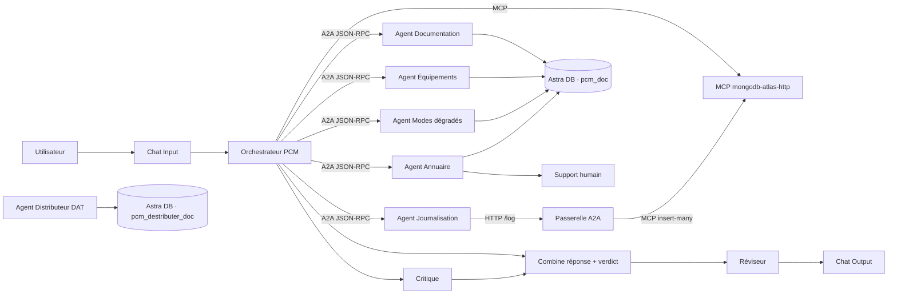
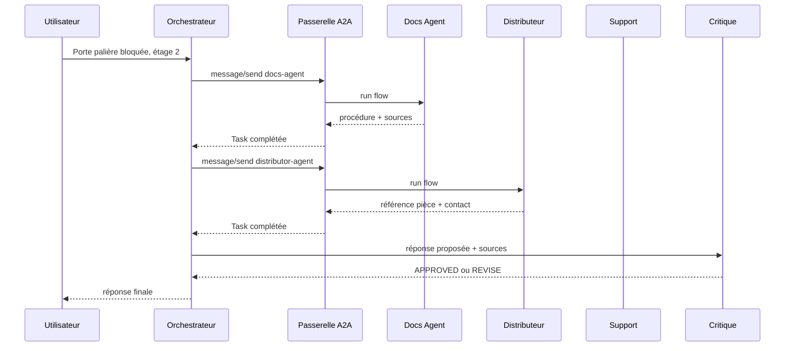

# Architecture du Hub PCM

## Vue d'ensemble



Le hub expose cinq agents du brief derrière une interface A2A unique : documentation, équipements, modes dégradés, annuaire et critique. Deux agents supplémentaires sont disponibles hors brief : distributeur DAT et journalisation. L'orchestrateur reste le seul point d'entrée utilisateur.

## Fan-out déterministe

Le flow `PCM Agent · Fanout` remplace l'orchestrateur tool-calling par un fan-out contrôlé :

1. Chat Input est envoyé aux quatre agents en parallèle via des composants `A2A Call`.
2. Quatre `Combine Text` assemblent la question et les quatre réponses.
3. Le critique relit l'ensemble, le réviseur produit la réponse finale.
4. `Contact Enricher` restaure les numéros exacts si le réviseur les a remplacés par « contact à confirmer ».
5. Si le réviseur renvoie une réponse vide, l'enrichisseur publie le texte combiné des agents.

Ce choix évite la dépendance au tool calling des modèles gratuits et tient en 16 à 24 secondes.

## Composants

| Composant | Rôle | Technologie |
|---|---|---|
| Orchestrateur PCM | Diagnostic, routage, synthèse, décision d'escalade | Agent Langflow + 4 outils A2A + outils MCP |
| Agent Documentation | Procédure et sécurité, RAG agentique | Agent Langflow + Astra DB `pcm_doc` |
| Agent Équipements | EQ-PSD-ALIM, EQ-PSD-CTRL, EQ-PSD-OBS, points de contrôle | Agent Langflow + Astra DB `pcm_doc` |
| Agent Modes dégradés | D1, D2, D3, mesures et décision | Agent Langflow + Astra DB `pcm_doc` |
| Agent Annuaire | Contacts, horaires, conditions d'appel | Agent Langflow + Astra DB `pcm_doc` |
| Agent Distributeur DAT | DAT et monnayeur, hors brief porte palière | Agent Langflow + Astra DB `pcm_destributer_doc` |
| Agent Journalisation | Enregistrement question et réponse finale | Agent Langflow + outil `log_interaction` + MCP |
| Critique | Contrôle sécurité, ancrage, complétude | Agent Langflow, sortie JSON |
| Réviseur | Correction bornée de la réponse | Agent Langflow |
| Passerelle A2A | AgentCards, JSON-RPC, adaptation Langflow | Node.js + Express |
| MCP MongoDB Atlas | Recherche d'actif, historique, ticket | Serveur MCP `mongodb-atlas-http` |

## AgentCards

Chaque carte est servie à l'URL `PUBLIC_BASE_URL/{agentId}/.well-known/agent-card.json` et exportée dans `agent-cards/`.

Champs renseignés : `protocolVersion`, `name`, `description`, `url`, `preferredTransport`, `version`, `provider`, `capabilities`, `defaultInputModes`, `defaultOutputModes`, `skills`, `securitySchemes`, `security`.

Les compétences sont décrites avec `id`, `name`, `description`, `tags`, `examples`, `inputModes`, `outputModes` pour rester exploitables par un autre agent ou un annuaire.

## Protocole A2A

Transport : HTTP POST, JSON-RPC 2.0.

Méthodes :

| Méthode | Paramètres | Résultat |
|---|---|---|
| `message/send` | `message` avec `parts[]` texte | `Task` complétée |
| `tasks/get` | `id` de la tâche | `Task` conservée 30 minutes |

Exemple de requête :

```json
{
  "jsonrpc": "2.0",
  "id": "demo-1",
  "method": "message/send",
  "params": {
    "message": {
      "kind": "message",
      "messageId": "m-1",
      "role": "user",
      "parts": [{ "kind": "text", "text": "Porte palière bloquée au 2e étage" }]
    }
  }
}
```

Exemple de résultat :

```json
{
  "jsonrpc": "2.0",
  "id": "demo-1",
  "result": {
    "kind": "task",
    "id": "uuid",
    "contextId": "uuid",
    "status": { "state": "completed", "timestamp": "2026-11-12T20:00:00.000Z" },
    "artifacts": [
      { "artifactId": "uuid", "name": "Agent Documentation PCM response", "parts": [{ "kind": "text", "text": "..." }] }
    ],
    "history": ["message utilisateur", "message agent"],
    "metadata": { "agentId": "docs-agent", "flowId": "...", "durationMs": 4210 }
  }
}
```

Codes d'erreur : `-32600` requête invalide, `-32601` méthode inconnue, `-32602` paramètres invalides, `-32000` erreur du flow amont, `-32001` tâche inconnue.

## Séquence d'une demande



## RAG agentique

Les agents documentation et distributeur ne suivent pas une chaîne fixe « recherche puis réponse ». Le prompt impose une boucle : reformulation en plusieurs requêtes, recherche, évaluation de la preuve (directe, partielle, absente), nouvelle recherche avec un vocabulaire différent si la preuve est partielle, puis réponse citée ou refus explicite. Cette boucle est visible dans les traces Langflow et dans les réponses.

## Auto-réflexion

Le critique reçoit la réponse de l'orchestrateur et renvoie un JSON strict avec `status`, `safety_block`, `issues`, `required_fix`. Un composant Combine Text concatène la réponse initiale et le verdict. Le réviseur corrige uniquement les problèmes listés, sans ajouter de fait. La sortie du réviseur est la réponse finale. Une seule passe de correction est appliquée, ce qui borne la latence et évite les cycles infinis. Le verdict reste inspectable sur le nœud Critique dans Langflow pour la démonstration.

## Interopérabilité

- **MCP** : le serveur `mongodb-atlas-http` est utilisé par l'agent journalisation pour écrire chaque interaction dans `pcm_agent.interactions` via `insert-many`, et par l'agent support pour la recherche d'actif et la création de ticket. Les appels sont tracés dans Langflow et dans le journal du serveur MCP.
- **A2A** : les trois agents spécialisés sont joignables par JSON-RPC et découvrables par AgentCard. L'orchestrateur utilise un composant Langflow dédié qui appelle la passerelle.
- **Agents** : le orchestrateur et les agents échangent des messages texte structurés. Les identifiants de tâche et de contexte assurent la traçabilité.

## Déploiement

Deux options :

1. **Tunnel cloudflared** pour la démo : `cloudflared tunnel --url http://localhost:8787`. L'URL change à chaque redémarrage, il faut mettre à jour `PUBLIC_BASE_URL` et régénérer les cartes.
2. **Hébergement** Render, Fly.io ou équivalent : URL stable, variables d'environnement, health check sur `/healthz`.

La passerelle doit être joignable depuis le backend Langflow, pas depuis le navigateur. Un `localhost` local ne fonctionne pas pour les flows exécutés sur staging.

Sur ce déploiement staging, les clés API Langflow sont refusées (`SESSION_INVALID`). La passerelle utilise donc `LANGFLOW_RUN_MODE=public` et l'endpoint `/api/v1/run/public/{flowId}?user_id=...`. Les flows exposés passent en `access_type: PUBLIC` le temps de la démonstration. Conséquence : toute personne qui connaît l'identifiant du flow et celui de l'utilisateur peut l'exécuter. Le jeton Bearer de la passerelle reste obligatoire pour l'entrée A2A, et les flows doivent repasser en privé après la démo.

## Sécurité

- Jeton Bearer partagé sur `POST /:agentId`, comparaison en temps constant.
- Cartes publiques, sans identifiant de flow ni secret.
- Secrets uniquement en variables d'environnement.
- Journaux sans contenu utilisateur complet : longueurs, identifiants, durée, statut.
- Une réponse d'erreur amont est renvoyée en `-32000`, jamais de stack trace.

## Observabilité

Chaque appel écrit une ligne NDJSON dans `logs/a2a-requests.ndjson` : horodatage, `requestId`, `agentId`, `flowId`, `taskId`, `contextId`, durée, nombre de caractères, statut. Ces lignes servent de preuve dans la démo et de base pour un futur tableau de bord.

## Correspondance avec les critères de validation

| Critère | Implémentation | Preuve |
|---|---|---|
| Interopérabilité | MCP + A2A JSON-RPC + AgentCards | Cartes servies, logs A2A, appels MCP |
| Agentic RAG | Boucle de recherche et gradation de preuve dans les prompts | Trace Langflow, sources citées |
| Collaboration | Orchestrateur + 2 spécialistes sur une même demande | Scénario 2 de la démo |
| Auto-réflexion | Critique JSON + Combine Text + réviseur, une passe | Verdict et réponse révisée |
| Architecture | Ce document + diagramme Mermaid | `docs/ARCHITECTURE.md` |
| Documentation | Guide, 4 AgentCards, fiche critique | `docs/GUIDE.md`, `agent-cards/` |
| Démonstration | 3 scénarios métier | `docs/DEMO.md`, vidéo |

## Modes de défaillance

| Panne | Comportement | Détection |
|---|---|---|
| Passerelle arrêtée | L'outil A2A renvoie `A2A_ERROR`, l'orchestrateur escalade | `/healthz` |
| Flow spécialisé en erreur | JSON-RPC `-32000` | Log NDJSON |
| Réponse vide | `-32000` avec message explicite | Test de fumée |
| Timeout | Nouvel essai puis `-32000` | Durée dans le log |
| Jeton invalide | HTTP 401 | Test d'intégration |
| Critique en échec | Réponse publiée avec avertissement et escalade | Trace du critique |
